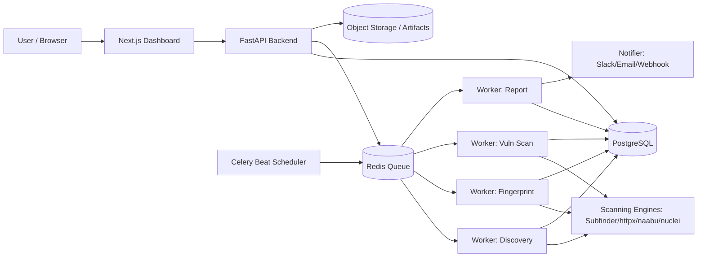

# PLAN_ASM.md — SentinelASM

> Rencana pembangunan **SentinelASM**: platform Attack Surface Management (ASM)
> untuk tim SOC. Cukup masukkan satu domain, sistem mengotomasi recon →
> fingerprinting → vulnerability scanning → reporting, dilengkapi dashboard
> manajemen.

---

## 0. Konteks & Keputusan yang Dikonfirmasi

| Aspek | Keputusan |
|---|---|
| Penyelenggara | Hackathon oleh **Angkatan Darat** — kegiatan terlegalisir, bebas berkreasi |
| Legalitas | Pemindaian sah untuk aset dalam kegiatan; sistem **tetap** menyediakan *scope guard* sebagai praktik baik dan bukti kedewasaan sistem |
| Waktu pengerjaan | Masih longgar → roadmap lengkap (Fase 0–7, Tier 1–3) dikejar penuh |
| Izin lingkungan | Boleh memasang dependensi/tool di mesin (kecuali file berbahaya) |
| Nama proyek | **SentinelASM** |
| Kanal notifikasi | **Telegram** (utama); webhook/email/Slack opsional |
| AI/LLM | **tokenizer.id** (`https://tokenizer.id/v1`), 35 model; `kimi-k3` dikecualikan (akses ditolak) |
| Frontend | Next.js + TypeScript (sudah di-scaffold di `frontend/`) |

---

## 1. Ringkasan

SentinelASM menerima sebuah domain target, lalu secara otomatis:

1. **Discovery** — memetakan seluruh aset yang terekspos (subdomain, IP, port, layanan).
2. **Fingerprinting** — mengenali teknologi, web server, CMS, dan sertifikat TLS.
3. **Vulnerability Scanning** — mendeteksi kerentanan dan miskonfigurasi.
4. **Risk Scoring** — menilai dan memprioritaskan risiko tiap aset.
5. **Reporting** — menyusun laporan otomatis untuk tim SOC.
6. **Management Dashboard** — memantau aset, menelusuri temuan, dan menindaklanjuti remediasi.

Sifatnya **berkelanjutan (continuous)**: scan dijadwalkan ulang dan hasilnya
di-diff untuk mendeteksi aset atau kerentanan baru.

---

## 2. Masalah yang Diselesaikan

- Tim SOC tidak punya visibilitas lengkap atas aset organisasi (shadow IT, subdomain terlupakan, layanan staging yang masih terbuka).
- Recon dan pemindaian masih manual, lambat, dan tidak konsisten antar-operator.
- Tidak ada sumber kebenaran tunggal untuk memprioritaskan risiko antar-aset.
- Pelaporan ke manajemen masih dikerjakan manual dan memakan waktu.

---

## 3. Target Pengguna

- **Tim SOC / Blue Team** — monitoring dan triase kerentanan harian.
- **Tim Red Team / Pentester** — mempercepat fase recon.
- **Manajemen keamanan / CISO** — melihat ringkasan postur risiko.

---

## 4. Fitur Utama

### 4.1 Asset Discovery
- Input domain → enumerasi subdomain secara pasif (Certificate Transparency: crt.sh) dan aktif (DNS brute-force dengan wordlist).
- Resolusi DNS (A, AAAA, CNAME, MX, TXT, NS).
- Port scanning ringan (top 1000 port) + deteksi layanan dan versi.
- Deteksi wildcard DNS dan CDN agar tidak menghasilkan false positive aset.

### 4.2 Fingerprinting
- Deteksi teknologi via header HTTP, body, dan favicon (web server, framework, CMS, library JS).
- Pengambilan dan parsing sertifikat TLS (issuer, masa berlaku, SAN, versi protokol).

### 4.3 Vulnerability Scanning
- Template-based scanning (mis. Nuclei) untuk CVE dan miskonfigurasi umum.
- Pemetaan versi layanan ke database CVE (NVD) untuk temuan berbasis versi.
- Pemeriksaan header keamanan yang hilang (HSTS, CSP, X-Frame-Options), TLS lemah, direktori/file sensitif yang terekspos, dan default credentials pada layanan umum.

### 4.4 Risk Scoring
- Skor per aset dari kombinasi: tingkat keterpaparan (internet-facing), severity temuan (CVSS), kemudahan eksploitasi, dan umur/validitas sertifikat.
- Klasifikasi **Critical / High / Medium / Low / Info**.
- Prioritas berdasarkan "yang paling mudah dieksploitasi & paling terekspos".

### 4.5 Reporting
- Ringkasan eksekutif (postur risiko, tren) dan detail teknis (daftar temuan + bukti + rekomendasi remediasi).
- Ekspor PDF / HTML / JSON / CSV.
- Template laporan yang bisa disesuaikan per klien/departemen.

### 4.6 Management Dashboard
- Tabel aset dengan filter/sort berdasarkan risiko, teknologi, dan status.
- Halaman detail aset: riwayat scan, temuan, sertifikat, port.
- Grafik tren risiko dan komposisi temuan.
- Manajemen target (tambah/hapus domain) dan penjadwalan scan.
- Status remediasi (Open / In Progress / Resolved / False Positive).

### 4.7 Alerting & Continuous Monitoring
- Notifikasi saat aset baru muncul, port baru terbuka, atau temuan baru terdeteksi.
- Kanal utama: **Telegram Bot** (lihat **Bagian 16**); webhook/email/Slack opsional.
- Jadwal scan berkala (mis. harian/mingguan) dan diff antar hasil scan.

### 4.8 Manajemen Akses (secara sederhana)
- Autentikasi pengguna dan peran dasar (Admin / Analyst / Viewer).

---

## 5. Arsitektur Teknis

| Lapisan | Pilihan | Alasan |
|---|---|---|
| API Backend | **Python + FastAPI** | Ekosistem security tooling Python paling kaya, async untuk orkestrasi job |
| Task Queue | **Celery + Redis** | Menjalankan scan asinkron dan paralel, mendukung retry & jadwal |
| Scheduler | **Celery Beat** | Penjadwalan scan berkala |
| Database | **PostgreSQL** | Data relasional aset, temuan, dan riwayat scan |
| Cache / Broker | **Redis** | Antrean job, cache hasil API eksternal, rate limiting |
| Scanning Engine | **Subfinder, Amass, dnsx, naabu, httpx, katana, nuclei, dan lainnya** | Tool recon & vuln scanning open-source yang matang (lihat **Bagian 14**) |
| Frontend | **React + Next.js + TypeScript** | Dashboard modern, SSR, ekosistem komponen luas |
| UI Components | **Tailwind CSS + komponen internal (`components/`) + lucide-react** | Lapisan komponen sendiri di atas token CSS — tanpa ketergantungan pustaka UI pihak ketiga (lihat **Bagian 17.1**) |
| Reporting | **WeasyPrint / ReportLab** | Konversi HTML → PDF |
| Notifikasi | **Telegram Bot API** (+ webhook/SMTP/Slack opsional) | Sesuai keputusan: Telegram jadi kanal utama |
| AI/LLM | **tokenizer.id** (OpenAI-compatible) | Ringkasan, triage, saran remediasi (lihat **Bagian 15**) |
| Container | **Docker + Docker Compose** | Reproducible, mudah dideploy dan dikembangkan |
| Reverse Proxy | **Nginx / Caddy** | TLS termination dan routing |

### Diagram Komponen



### Struktur Repo (terkini — sudah selaras)

```
sentinelasm/
├─ Makefile                # helper: up/down/logs/test/lint/proxy-up
├─ .env.example
├─ PLAN_ASM.md
├─ README.md
├─ backend/
│  ├─ app/
│  │  ├─ api/v1/         # endpoint FastAPI
│  │  ├─ core/           # konfig, security, settings
│  │  ├─ db/             # engine, session, tipe kolom
│  │  ├─ models/         # SQLAlchemy models
│  │  ├─ schemas/        # Pydantic schemas
│  │  ├─ services/       # logic bisnis (risk scoring, enrichment, reporting, storage)
│  │  ├─ scanners/       # wrapper tool eksternal + registry
│  │  └─ workers/        # task Celery (pipeline) + celery_app
│  ├─ alembic/           # migrasi DB
│  ├─ tests/             # smoke test end-to-end
│  ├─ pyproject.toml     # metadata + tooling (ruff, pytest)
│  ├─ requirements.txt   # dependensi untuk build Docker
│  └─ Dockerfile(.worker)
├─ frontend/
│  ├─ app/               # 9 rute: login, ikhtisar, targets(+[id]), assets, findings, scans, reports, settings
│  ├─ components/        # AppShell, ScanProgress, tabel, panel, tombol
│  ├─ lib/               # api, types, ui, format, hooks, cn
│  └─ Dockerfile
├─ deploy/
│  ├─ docker-compose.yml # stack utama (dijalankan dari root via make)
│  ├─ nginx/             # reverse proxy opsional (profile "proxy")
│  └─ run-local.sh       # alternatif Podman tanpa compose
└─ docs/                 # architecture, deployment, development, api
```


### Skema Data (inti)

- `targets` — domain yang dipantau, jadwal scan, status.
- `assets` — hasil discovery (subdomain/IP/port), terkait ke target.
- `services` — layanan terdeteksi per aset (port, teknologi, TLS).
- `findings` — temuan kerentanan (severity, CVE, bukti, status remediasi).
- `scans` — catatan eksekusi scan (waktu, jenis, status, ringkasan).
- `reports` — laporan yang dihasilkan.
- `users` / `roles` — akses.

---

## 6. Alur Kerja Sistem

```
Input domain
   │
   ▼
[1] Discovery  → subdomain, IP, port, layanan
   │
   ▼
[2] Fingerprint → teknologi, CMS, sertifikat TLS
   │
   ▼
[3] Vuln Scan  → Nuclei templates + CVE mapping + misconfig
   │
   ▼
[4] Risk Scoring → severity + exposure + exploitability
   │
   ▼
[5] Store & Diff → bandingkan dengan scan sebelumnya
   │
   ▼
[6] Report + Alert → PDF/HTML + notifikasi
   │
   ▼
[7] Schedule ulang → continuous monitoring
```

---

## 7. Alur Pengguna

1. User login, menambahkan domain target.
2. Sistem menjalankan discovery awal (async, progres tampil real-time di dashboard).
3. Fingerprinting dan vulnerability scan berjalan berurutan di worker.
4. Risk score dihitung; aset dan temuan muncul di dashboard.
5. User menelusuri temuan, menandai status remediasi, dan mengunduh laporan.
6. Scan berkala berjalan; sistem mengirim alert saat menemukan perubahan.

---

## 8. Rencana Kerja (Roadmap)

### Fase 0 — Fondasi (Hari 1–3)
- Setup repo, Docker Compose (Postgres, Redis, backend, frontend).
- Skema DB + migrasi Alembic.
- Autentikasi dasar dan kerangka API.

### Fase 1 — Discovery (Hari 4–7)
- Wrapper Subfinder / dnsx / naabu.
- Task Celery untuk discovery + penyimpanan hasil.
- Endpoint daftar aset.

### Fase 2 — Fingerprinting (Hari 8–10)
- Wrapper httpx; ekstraksi teknologi dan TLS.

### Fase 3 — Vulnerability Scanning (Hari 11–15)
- Integrasi Nuclei (template selection).
- Mapping versi layanan → CVE (NVD API).
- Pemeriksaan miskonfigurasi kustom.

### Fase 4 — Risk Scoring & Diffing (Hari 16–18)
- Algoritma skor risiko.
- Diff antar scan untuk deteksi perubahan.

### Fase 5 — Reporting & Alerting (Hari 19–22)
- Generator laporan (PDF/HTML/JSON/CSV).
- Notifikasi webhook/email/Slack.

### Fase 6 — Dashboard (paralel, Hari 10–24)
- Tabel & detail aset, grafik risiko, manajemen target, status remediasi.

### Fase 7 — Hardening & Dokumentasi (Hari 25–28)
- Rate limiting, isolasi worker, validasi scope/legal.
- Dokumentasi setup dan panduan pengguna.
- Uji end-to-end.

---

## 9. Skenario Demo

1. Tambahkan domain contoh (domain lab / yang diizinkan).
2. Tunjukkan discovery berjalan real-time (subdomain + port muncul bertahap).
3. Tampilkan dashboard: daftar aset dengan skor risiko dan grafik tren.
4. Buka satu aset → tampilkan temuan + bukti + rekomendasi.
5. Unduh laporan PDF.
6. Picu alert dengan mensimulasikan aset/port baru.

---

## 10. Risiko & Mitigasi

| Risiko | Mitigasi |
|---|---|
| **Legalitas & etika scanning** | Wajib hanya scan aset milik sendiri / ada izin tertulis; sediakan mekanisme verifikasi kepemilikan domain (mis. TXT record) |
| Rate limit API eksternal (crt.sh, NVD) | Cache di Redis, batasi concurrency, retry dengan backoff |
| False positive | Korelasi beberapa sumber + deteksi CDN/wildcard; status "False Positive" manual |
| Beban worker berat | Batas resource per worker, antrean prioritas, isolasi container |
| Keamanan data hasil scan | Enkripsi at-rest, akses berbasis peran, audit log |
| Scope creep | Fokus MVP dulu (discovery → dashboard), fitur lanjutan menyusul |

---

## 11. Metrik Keberhasilan

- Jumlah aset valid yang ditemukan otomatis dari satu domain input.
- Waktu dari input domain → hasil scan pertama tampil di dashboard.
- Presisi deteksi teknologi dan kerentanan (rasio false positive rendah).
- Kelengkapan laporan dan kejelasan visual risk scoring.
- Keandalan penjadwalan scan berkala.

---

## 12. Pengembangan Lanjutan

- Integrasi penuh NVD/CVE dan feed ancaman (mis. EPSS) untuk prioritas berbasis risiko nyata.
- Multi-tenant untuk konsultan/MSSP.
- Integrasi ticketing (Jira, ServiceNow) untuk alur remediasi.
- Dukungan cloud asset discovery (AWS/GCP/Azure) dan API eksternal.
- Deteksi perubahan & penyimpangan (drift detection) yang lebih canggih.
- CI/CD pipeline dan test otomatis (unit + integration + e2e).

---

## 13. Endpoint API (usulan)

| Method | Endpoint | Deskripsi |
|---|---|---|
| POST | `/api/v1/auth/login` | Login dan memperoleh token |
| GET | `/api/v1/targets` | Daftar domain target |
| POST | `/api/v1/targets` | Menambahkan domain target |
| DELETE | `/api/v1/targets/{id}` | Menghapus domain target |
| POST | `/api/v1/targets/{id}/scan` | Memicu scan manual |
| GET | `/api/v1/targets/{id}/scans` | Riwayat scan untuk satu target |
| GET | `/api/v1/assets` | Daftar aset (filter: risiko, teknologi, status) |
| GET | `/api/v1/assets/{id}` | Detail aset (port, teknologi, TLS) |
| GET | `/api/v1/findings` | Daftar temuan kerentanan |
| PATCH | `/api/v1/findings/{id}` | Update status remediasi temuan |
| GET | `/api/v1/reports` | Daftar laporan yang dihasilkan |
| POST | `/api/v1/reports/target/{id}?kind=pdf\|html` | Membuat artefak laporan baru |
| GET | `/api/v1/reports/target/{id}` | Laporan HTML inline |
| GET | `/api/v1/reports/{id}/download` | Mengunduh file laporan |
| GET | `/api/v1/system/scanners` | Status ketersediaan tiap scanner |
| GET | `/api/v1/dashboard/summary` | Ringkasan postur risiko untuk dashboard |
| POST | `/api/v1/webhooks/test` | Uji konfigurasi notifikasi webhook |
| POST | `/api/v1/integrations/telegram/test` | Uji kirim pesan ke Telegram |

---

## 14. Tooling Open-Source (Recon & Vulnerability Discovery)

SentinelASM tidak membangun mesin scanning dari nol, melainkan **mengorkestrasi
tool open-source terbaik** di setiap tahap pipeline. Setiap tool dibungkus
(*adapter*) sebagai subprocess/container, dan output-nya dinormalisasi ke skema
`findings` internal dengan penanda `source` agar bisa dikorelasikan.

### 14.1 Enumerasi Subdomain & DNS

| Tool | Fungsi |
|---|---|
| **Subfinder** | Enumerasi subdomain pasif dari puluhan sumber |
| **Amass** | Enumerasi pasif + aktif, pemetaan DNS & ASN |
| **Assetfinder** | Enumerasi cepat dari sumber publik |
| **Findomain** | Enumerasi subdomain multi-sumber |
| **dnsx** | Resolusi & probing DNS massal (A/AAAA/CNAME/MX/TXT) |
| **puredns / massdns** | Resolusi massal cepat (brute-force wordlist) |
| **shuffledns** | Brute-force subdomain massal |
| **alterx** | Permutasi nama subdomain (mendeteksi varian tersembunyi) |
| **crt.sh / Chaos** | Sumber data Certificate Transparency & dataset publik |

### 14.2 Port Scanning & Service Detection

| Tool | Fungsi |
|---|---|
| **Naabu** | Port scanning cepat (TCP SYN/CONNECT) |
| **Masscan** | Port scanning masif berkecepatan tinggi |
| **Nmap** | Service/versi detection, NSE scripts |
| **RustScan** | Port scanning cepat + auto-forward ke Nmap |

### 14.3 HTTP Probing & Fingerprinting

| Tool | Fungsi |
|---|---|
| **httpx** | Probing HTTP, status, title, header, teknologi, TLS |
| **tlsx** | Analisis detail sertifikat TLS & SAN |
| **WhatWeb** | Fingerprinting teknologi & CMS |
| **webanalyze / Wappalyzer CLI** | Deteksi teknologi dari pola aplikasi |

### 14.4 Crawling, URL & Parameter Discovery

| Tool | Fungsi |
|---|---|
| **katana** | Crawling modern (headless + JS parsing) |
| **gau (GetAllUrls)** | Mengambil URL historis (Wayback, Common Crawl, OTX) |
| **waybackurls** | URL historis dari Wayback Machine |
| **hakrawler / gospider** | Crawling ringan & ekstraksi link |
| **waymore** | Arsitektur URL historis lebih lengkap |
| **paramspider** | Menemukan parameter URL untuk pengujian |
| **LinkFinder** | Ekstraksi endpoint dari file JavaScript |

### 14.5 Content & Directory Discovery

| Tool | Fungsi |
|---|---|
| **ffuf** | Fuzzing cepat (dir/file/parameter/vhost) |
| **feroxbuster** | Content discovery rekursif berbasis Rust |
| **gobuster** | Brute-force dir/DNS/vhost |
| **dirsearch** | Directory & file discovery |
| **kiterunner** | Discovery endpoint API (routes) |

### 14.6 Vulnerability Scanning

| Tool | Fungsi |
|---|---|
| **Nuclei** | Scanning berbasis template (CVE, misconfig, exposed panel, default creds) — inti engine |
| **Nuclei-templates** | Koleksi template komunitas (auto-update) |
| **OWASP ZAP** | DAST web (baseline & full scan) |
| **Nikto** | Pemeriksaan miskonfigurasi web server |
| **WPScan** | Kerentanan khusus WordPress |
| **JoomScan** | Kerentanan khusus Joomla |
| **Dalfox** | Deteksi XSS otomatis |
| **SQLMap** | Deteksi & validasi SQL injection |
| **OpenVAS / Greenbone** | Scanning kerentanan infrastruktur (network-level) |
| **Trivy** | Kerentanan container/dependency (bila memindai image) |

### 14.7 TLS/SSL Assessment

| Tool | Fungsi |
|---|---|
| **testssl.sh** | Audit lengkap konfigurasi TLS (cipher, protokol, CVE) |
| **sslyze** | Analisis TLS terstruktur (Python) |
| **tlsx** | Ekstraksi cepat metadata sertifikat |

### 14.8 Secret & Credential Leak Detection

| Tool | Fungsi |
|---|---|
| **TruffleHog** | Deteksi secret di repo/konten & verifikasi |
| **Gitleaks** | Deteksi secret di git history |
| **Nuclei (exposed-* templates)** | Deteksi `.env`, kredensial default, file backup terbuka |

### 14.9 Screenshot & Visual Recon

| Tool | Fungsi |
|---|---|
| **gowitness** | Screenshot massal + galeri untuk triase cepat |
| **EyeWitness** | Screenshot + deteksi default creds header |
| **aquatone** | Screenshot & clustering halaman |

### 14.10 Subdomain Takeover & Cloud Exposure

| Tool | Fungsi |
|---|---|
| **Nuclei takeover templates** | Deteksi dangling CNAME / takeover |
| **subjack** | Deteksi subdomain takeover |
| **cloud_enum / S3Scanner** | Enumerasi bucket storage & cloud exposure publik |
| **can-i-take-over-xyz** | Referensi pola takeover |

### 14.11 Data Kerentanan & Threat Intel

| Sumber | Fungsi |
|---|---|
| **NVD API** | Metadata CVE & CVSS |
| **EPSS** | Probabilitas eksploitasi (prioritas berbasis risiko nyata) |
| **ExploitDB / searchsploit** | Ketersediaan PoC publik |
| **Vulners API** | Cross-reference CVE & exploit |
| **crt.sh / Shodan / Censys (API)** | Data aset & keterpaparan eksternal |

### 14.12 Orkestrasi Pipeline

- **Inti orkestrasi:** worker Celery SentinelASM memanggil tool per tahap dan mengalirkan hasil ke tahap berikutnya:

  ```go
  Subfinder/Amass → dnsx → naabu → httpx/tlsx → katana/gau → nuclei/ffuf → risk scoring
  ```

- **Add-on framework (opsional):** untuk mempercepat penyusunan pipeline, bisa mengadopsi pola dari **reconftw**, **osmedeus**, atau **Axiom** (eksekusi terdistribusi) — namun tetap dibungkus agar output konsisten dengan skema internal.

### 14.13 Pola Integrasi (Adapter)

Setiap tool diimplementasikan sebagai adapter dengan kontrak seragam:

```python
# backend/app/scanners/base.py
class ScannerAdapter(Protocol):
    name: str
    def run(self, target: Target) -> list[Finding]: ...
```

- Tool dijalankan di container terpisah (image resmi ProjectDiscovery / image kustom).
- Output (JSON/JSONL) dinormalisasi ke skema `findings` + `services`.
- Setiap temuan menyimpan `source` (mis. `nuclei`, `nikto`), `severity`, `cve`, `evidence`, dan `confidence` untuk korelasi & penekanan false positive.

### 14.14 Matriks Prioritas Implementasi

| Tier | Tool | Alasan prioritas |
|---|---|---|
| **Tier 1 (MVP)** | subfinder, dnsx, naabu, httpx, nuclei, tlsx, ffuf | Cepat diintegrasikan, dampak besar, output JSON rapi |
| **Tier 2** | katana, gau, testssl.sh, gowitness, WPScan/Nikto, trufflehog | Memperluas cakupan & kedalaman |
| **Tier 3** | ZAP, SQLMap, Dalfox, OpenVAS, cloud_enum, Axiom | Berat/risiko lebih tinggi, untuk pengujian mendalam & terdistribusi |

### 14.15 Mode Aman & Legal

- **Safe/Passive mode:** hanya tool pasif (subfinder, gau, crt.sh) tanpa paket aktif ke target.
- **Rate limiting global** untuk menghormati target dan API eksternal.
- Wajib verifikasi kepemilikan domain + checklist izin sebelum mode aktif/agresif (nuclei severity tinggi, SQLMap, brute-force) diaktifkan.

---

## 15. Lapisan AI/LLM (tokenizer.id)

SentinelASM memakai LLM untuk **membantu** analis (ringkasan, triage, saran remediasi),
bukan menggantikan keputusan akhir analis.

Endpoint OpenAI-compatible: `https://tokenizer.id/v1` (kredensial via env
`TOKENIZER_API_KEY`). Tersedia **35 model**.

| Tugas | Model default | Fallback |
|---|---|---|
| Triage cepat & klasifikasi false positive (batch) | `deepseek-v4.1-flash` / `gemini-3.8-flash` | `glm-5.3-flash` |
| Penjelasan & rekomendasi remediasi per temuan | `claude-sonnet-5.5` | `gpt-6-sol` |
| Ringkasan eksekutif laporan | `claude-opus-5` | `claude-sonnet-5.5` |

Catatan implementasi:

- **`kimi-k3` dikecualikan** — API key saat ini ditolak untuk model tersebut
  (`access denied: this API key is not permitted to use model kimi-k3`).
- Model default per tugas dapat diubah dari halaman **Settings**; rantai fallback otomatis
  aktif saat error, 401/403, atau timeout.
- Output wajib **JSON terstruktur** dan divalidasi Pydantic; hasil di-cache berdasarkan
  hash temuan agar hemat token.
- **Privasi:** hanya metadata temuan yang dikirim ke LLM; nilai secret yang ditemukan
  disamarkan terlebih dahulu.
- Setiap teks hasil AI diberi label "AI-generated" di dashboard dan laporan.

---

## 16. Notifikasi Telegram

- Bot dibuat via `@BotFather`; konfigurasi lewat env `TELEGRAM_BOT_TOKEN` dan
  `TELEGRAM_CHAT_ID`.
- Event yang memicu notifikasi:
  - Scan selesai (ringkasan jumlah temuan baru per severity).
  - Temuan baru severity **Critical/High** atau terdaftar di **CISA KEV**.
  - Aset/port baru terdeteksi pada scan berkala (hasil diff).
  - Scan gagal / timeout.
- Format pesan Markdown ringkas dengan *deep link* ke dashboard (`/scans/{id}`,
  `/findings/{id}`).
- Retry pengiriman; jika tetap gagal, dicatat ke tabel `notifications` dengan status
  `failed` sebagai fallback.
- Tombol on/off per jenis event tersedia di **Settings → Integrations**, plus endpoint
  uji `POST /api/v1/integrations/telegram/test`.

---

## 17. Status Deployment (live)

Backend sudah berjalan di server pribadi (Proxmox) dan dapat diakses publik:

| Item | Nilai |
|---|---|
| API | <https://asm.ahyarni.my.id> (`/docs`, `/health`) |
| Dashboard | <https://asm-app.ahyarni.my.id> |
| Host | Proxmox `pve` `192.168.18.30` |
| Container | LXC `ct-asm` `192.168.18.105` (3 vCPU / 3 GB / 40 GB) |
| Stack | `postgres`, `redis`, `backend`, `worker`, `beat`, `frontend` (profile `web`) |
| Ingress | Cloudflare Tunnel (`ct-tunnel` 102) |
| Registrasi | publik **dimatikan** (`ALLOW_REGISTRATION=false`) |

Rincian operasional: [`docs/server-ct-asm.md`](./docs/server-ct-asm.md).

### 17.1 Sistem Desain Dashboard

Tampilan dashboard diselaraskan dengan referensi visual yang diminta
(<https://nutaraline.co.uk/>) — kertas tulang hangat, tinta hijau tua, kartu
bergaris rambut, dan nav kaca mengambang — lalu disesuaikan dengan kebutuhan ASM.

| Aspek | Nilai |
|---|---|
| Tipografi | DM Sans, di-host sendiri (`frontend/public/fonts/`) |
| Kertas / tinta | `#f5f5ee` / `#29392d` |
| Permukaan | `#fffef9` / `#ffffff` dengan garis rambut `#dce2d4` |
| Aksen | hijau `#315e43`, sorotan `#a8cf94`, chip `#e3ecd9` |
| Radius | 16px (kartu) · 22px (panel) · 12px (kontrol) |
| Sumber token | `frontend/app/globals.css` (`:root`) → `frontend/tailwind.config.ts` |

Aturan yang dipegang: semua warna hanya lewat token di `globals.css` (tanpa hex di
komponen), grafik distribusi severity digambar sebagai bar CSS (ketergantungan
`recharts` dilepas), dan setiap kelas varian ditulis sebagai literal utuh supaya
tidak ter-*purge* Tailwind — karena itu `./lib/**` ikut dipindai di
`tailwind.config.ts`.

Uji end-to-end pertama (target `scanme.nmap.org`) **berhasil**: scan `completed` dalam
±4m44s, menghasilkan 1 aset / 4 service / 20 endpoint / 22 temuan (2 medium, 20 info),
dan datanya langsung tampil di dashboard.

**Belum diimplementasikan / langkah berikutnya**

1. Fitur §15 (AI/LLM) dan §16 (Telegram) belum diimplementasikan.
2. Endpoint yang belum ada tetap seperti dicatat di [`docs/api.md`](./docs/api.md)
   (mis. `POST /auth/change-password`, diff, schedules, users, audit-logs).
3. Penjadwalan per target belum dihormati: tugas beat memindai **semua** target
   setiap hari tanpa melihat `schedule_cron`, sehingga target tidak bisa
   di-*opt out* dari pemindaian harian.
4. `POST /targets/{id}/scan` belum menolak scan ganda yang masih berjalan. UI
   menonaktifkan tombolnya, tetapi API masih menerima.

### 17.2 Progres scan & pemecahan dashboard (16 Okt 2026)

Progres yang ditampilkan adalah data nyata, bukan persentase karangan:

| Bagian | Sumber data | Berkas |
|---|---|---|
| Timer berjalan | `scans.started_at` (sudah ada) | `frontend/components/ScanProgress.tsx` |
| Stepper 6 fase | kolom baru `scans.phase` | `backend/app/workers/tasks.py` |
| Hitungan sementara | `scans.summary` ditulis per fase, bukan hanya di akhir | `backend/app/workers/tasks.py` |
| Error scanner | `summary.scanner_errors` / `summary.error` | `frontend/components/ScanProgress.tsx` |
| Status scanner | inventaris dari container worker lewat Redis (`sentinelasm:scanners`) | `backend/app/workers/tasks.py`, `backend/app/api/v1/system.py` |

Migrasi baru: `a7c1f2b9d4e6_add_scan_phase`. Dashboard dipecah menjadi 9 rute:
`/login`, `/` (Ikhtisar), `/targets`, `/targets/[id]`, `/assets`, `/findings`,
`/scans`, `/reports`, `/settings` — di bawah grup rute `(dashboard)` dengan
`AppShell`, `useRequireAuth`, dan hook `useResource` (polling adaptif: 4 detik saat
ada scan berjalan, 15–30 detik saat idle).

Endpoint baru/pendukung: `GET /scans` (riwayat semua target) dan filter `target_id`
pada `GET /findings`. Bila broker tidak dapat dihubungi, `POST /targets/{id}/scan`
kini membalas **503** dengan pesan jelas — sebelumnya 500 tanpa header CORS sehingga
UI hanya menampilkan “Failed to fetch”.

